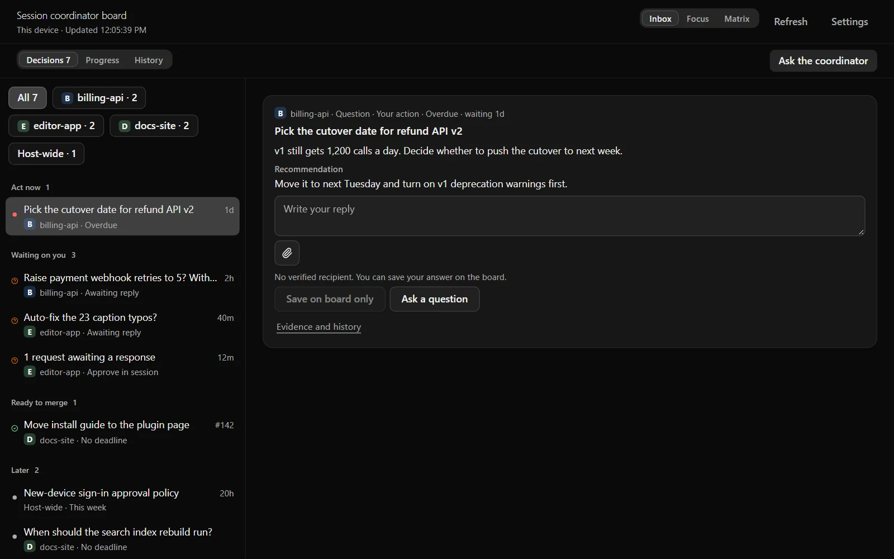
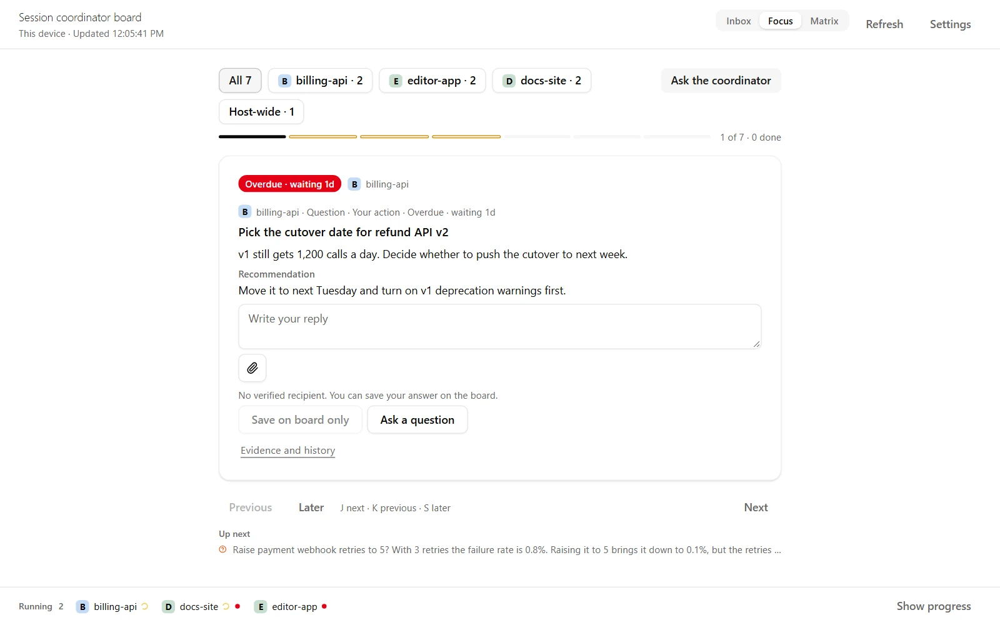
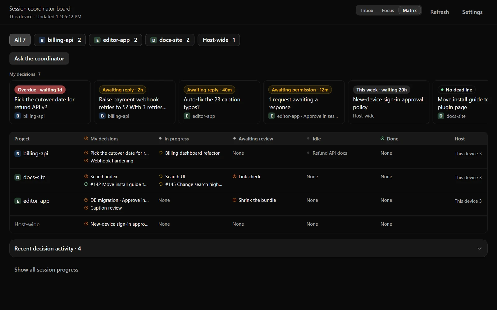
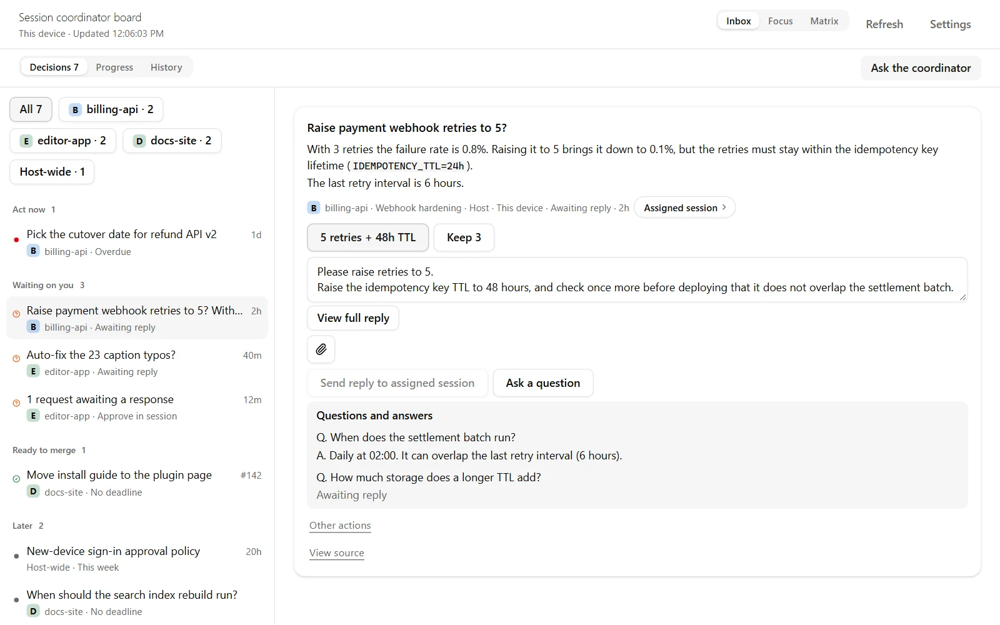
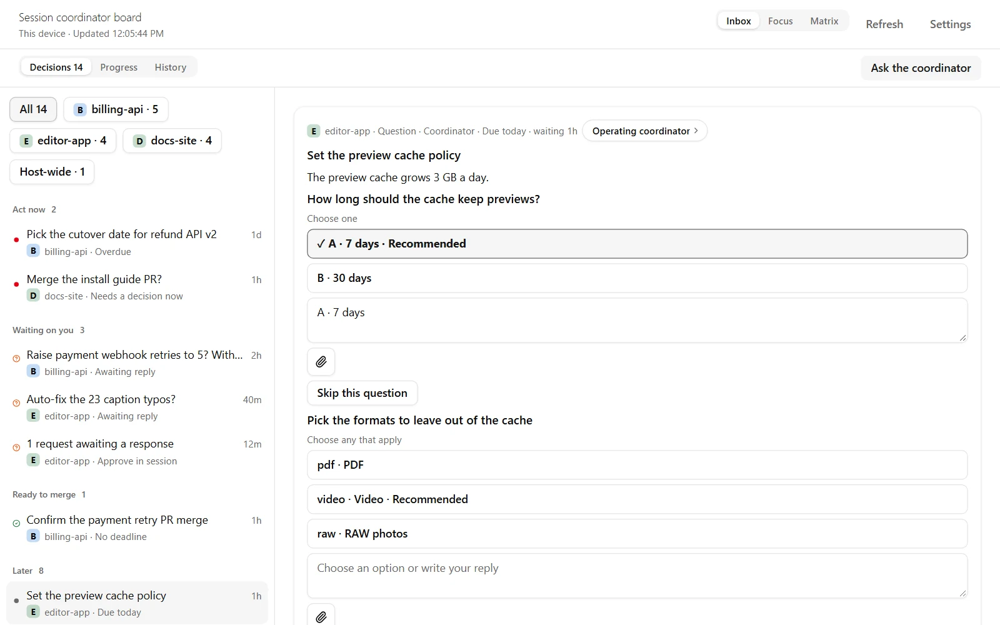
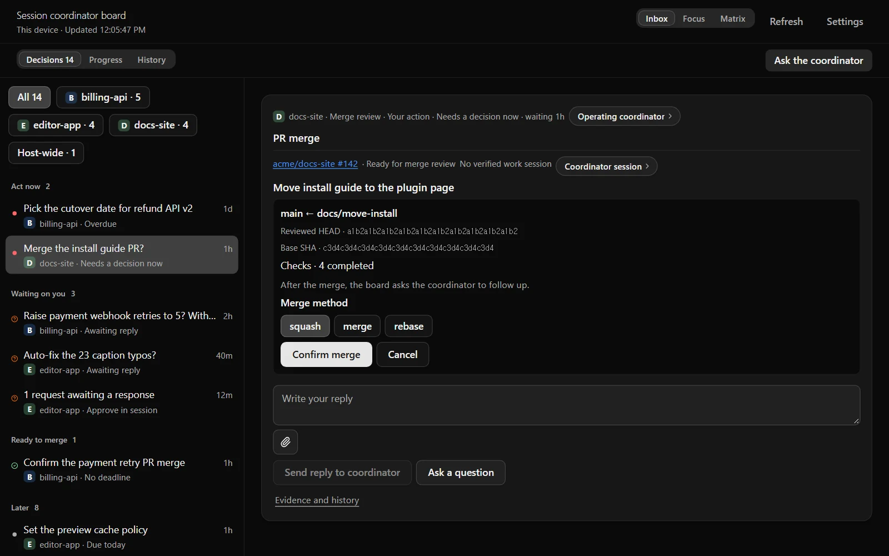

<div align="center">


# Coordinator Board

**あなたを待っているエージェントセッションを、ひとつの場所に。**<br>
[Orca](https://github.com/stablyai/orca) のエージェントセッションをプロジェクトごとにまとめ、人の判断が必要なもの(質問、権限リクエスト、マージできる PR)をひとつのボードに集めて、その場で返答できるようにする Orca プラグインです。

[](https://github.com/stablyai/orca-community-plugins)
[](https://github.com/stablyai/orca)
[](LICENSE)
[](https://github.com/devbrother2024/paseo-coordinator-board)

[English](README.md) · [한국어](README.ko.md) · **日本語** · [简体中文](README.zh-CN.md)


</div>

## なぜ作ったか

コーディングエージェントを 5 つ、10 と同時に動かすと、ボトルネックは人になります。ひとつは質問し、ひとつは権限を待ち、ひとつは 1 時間前に PR を開いたまま。それぞれが別のターミナルやチャットタブにいます。Coordinator Board はそれらをすべて見守り、人が決めるべきことを順番にひとつのリストへ並べます。タブを探し回らず、上から順に返答するだけです。

## 機能

- **ひとつの判断キュー。** 権限リクエスト、質問、確認を求めて終わったセッション、レビュー可能な PR を、緊急度順、同じなら待ち時間の長い順に表示します。
- **その場で返答。** 返答カードにはセッションの最近の出力とコーディネーターの推奨が表示されます。選択肢ボタンは返答欄を埋めるだけで、内容を読んで直してから送信します(⌘/Ctrl+Enter)。
- **3 つのビュー。** **Inbox**(一覧と詳細)、**Focus**(1 件ずつ、`J` / `K` / `S` ショートカット)、**Matrix**(プロジェクト × セッション状態)。
- **サイドバーパネル。** Orca の右サイドバーに同じ Focus カードを表示し、エディターを離れずに返答できます。ステータスバーには待機中の判断数が出ます。
- **コーディネーターエージェント。** コーディネーターセッションを起動するか既存のセッションを指定します。`coordinator-board` シェルコマンドでダイジェストを書き、返答を推奨し、難易度に応じてワーカーエージェントを割り当てます。
- **判断レコード。** コーディネーターが単一選択・複数選択の質問、根拠、履歴を含むレコードを残します。作業中のセッションへの返答はキューに入り、ターンが終わったときに一度だけ送られます。
- **PR のマージ。** 対象ブランチ、レビュー済み HEAD、チェック状態を確認し、マージ方法を選んでボードからマージします。コーディネーターに後続作業を知らせます。
- **作業の追跡。** コーディネーターが割り当てた作業は完了条件を持ちます。報告なしで終わったターンや、マージまたはクローズされた PR は完了候補にとどまり、ボードがセッションに一度だけ確認します。完了報告や放置はコーディネーターに知らせ、完了を確定できるのはコーディネーターの `verify` か人だけです。`verify` が作業を差し戻すのは 2 回までで、3 回目の失敗はもう一巡させず、人の決定カードに上げます。入力待ちの作業は時間が経っても放置とみなしません。
- **写真。** 返答、質問、コーディネーターへの依頼に画像を 4 枚まで(JPEG、PNG、WebP)添付できます。
- 韓国語と英語の UI、ライトテーマとダークテーマに対応しています。

## スクリーンショット

| Inbox | Focus |
| --- | --- |
|  |  |
| **Matrix** | **選択肢で返答** |
|  |  |
| **判断レコード** | **ボードからマージ** |
|  |  |

## インストール

Orca 1.4.259 以降が必要です。

**プラグイン一覧から:** Orca で **Settings → Plugins** を開き、コミュニティカタログから **Coordinator Board** を探してインストールします。

**コマンドラインから:**

```sh
orca plugin install hseunghwan/orca-coordinator-board
```

コードを実行するプラグイン(trusted worker)なので、Orca は要求する権限の一覧と `--approve <fingerprint>` 付きのコマンドを表示します。一覧を読んで、ご自身で承認してください。

その後、右サイドバーの **Coordinator Board** パネルかステータスバーの **Board** をクリックし、見守るプロジェクトを選びます。PR はこのコンピューターでログイン済みの `gh` CLI で読み込みます。ない場合は PR 欄だけが空になります。

### 要求する権限

| 権限 | 用途 |
| --- | --- |
| `storage:own` | ステータスバーの表示言語 |
| `workspace:read` | プロジェクト、ワークスペース、ターミナルの一覧 |
| `agent:read` | エージェントの状態(権限待ち、返答待ち、作業中、完了) |
| `terminal:read` | 返答カードに表示するターミナルの最近の出力 |
| `terminal:send` | あなたが書いて送信した返答の入力 |
| `workspace:write` | セッションのターミナルへの移動、チャットワークスペースとダッシュボードファイルを開く |
| `agent:launch` | 現在は未使用(コーディネーターは `orca agent launch` CLI で起動) |
| `history:read` | 現在は未使用 |

## 仕組み

- **表示される場所。** ステータスバーの件数、全幅のダッシュボードタブ(コマンドパレット: `Coordinator Board: Open dashboard`)、右サイドバーパネル。
- **ダッシュボードタブ。** Orca プラグインは自分でエディタータブを開けないため、ダッシュボードは `.coordinator-board` ファイル用のカスタムエディターです。開くと、フォーカス中のワークスペースに `.coordinator-board/board.coordinator-board` を書きます(`.git/info/exclude` で隠し、`.gitignore` は作りません)。ファイルにはデータがなく、内容はすべてワーカーが読み込みます。
- **データ。** 選んだプロジェクト、コーディネーター、メモ、返答の受領記録は `~/.orca-coordinator-board/` に、Paseo 版と同じ形式で保存します。
- **コーディネーター。** 専用のフォルダープロジェクト(「Coordinator home」)で `orca agent launch` により起動します。起動記録を先に書くため、応答が途切れても再確認するだけで二重に起動しません。ワーカーには推奨の権限モードを使い、バイパスモードは与えません。

### 送信のルール

- あなたが書いて送信した文章だけを、そのままセッションに入力します。
- 送信直前にセッションの状態を読み直します。権限待ち、作業中、カードを開いた後に状態が変わったセッションには送りません。
- 失敗しても自動では再送しません。
- ボード自身が作る文(事実の回答、マージ通知)は、ターミナルでは `[coordinator-board]` ヘッダーを付け、チャットセッションには署名付きメールで送ります。別の経路に切り替えて送ることはしません。

詳しい動作(韓国語): [docs/details.ko.md](docs/details.ko.md)

## Paseo 版との違い

Orca が提供しない機能のため、ボードでは省いています: ワークスペースのピン留め、実行中のターンへの割り込み、ワーカーを起動したエージェントの記録(ボードが `workers.json` に別途保存)、ターミナルエージェントの権限モードの読み取り、ターミナルが閉じたセッションへの送信。

## 開発

```sh
npm ci                  # 開発ツールのみ。プラグインの実行に node_modules は不要
orca plugin types .     # .orca/types を生成(コミットしない)
npm run build           # dist/worker.mjs, dist/cli.cjs, dist/dashboard.js, dist/dashboard.html
npm run typecheck
orca plugin test .      # vitest
orca plugin check .
orca plugin validate .
node dev/build.mjs      # 偽の window.orca と架空のボードでダッシュボードのハーネスを作成
node dev/shoot.mjs      # ヘッドレス Chrome/Edge で dev/shots/ に画面を保存(掲載用: node dev/shoot.mjs ^listing)
```

`dist/` はリポジトリに含めています。git でインストールするとビルドなしで動きます。コーディングエージェント向けのルールは [AGENTS.md](AGENTS.md) にあります。

## クレジット

このプラグインは DevBrothers による **[paseo-coordinator-board](https://github.com/devbrother2024/paseo-coordinator-board)**(MIT)を Orca 向けに移植したものです。ボードの構成、判断の並び順、送信ルール、PR の分類はそのプロジェクトに由来し、`src/paseo/` はその判断ロジックとテストを import パスだけ変えて取り込んでいます。原作者の皆さんに感謝します。

同梱した Marked と Better Paseo のコードに関する告知は [THIRD_PARTY_NOTICES.md](THIRD_PARTY_NOTICES.md) にあります。プロジェクトの骨組みは Orca の `orca plugin create` テンプレート(stablyai/orca, MIT)から始めました。

## ライセンス

[MIT](LICENSE)
