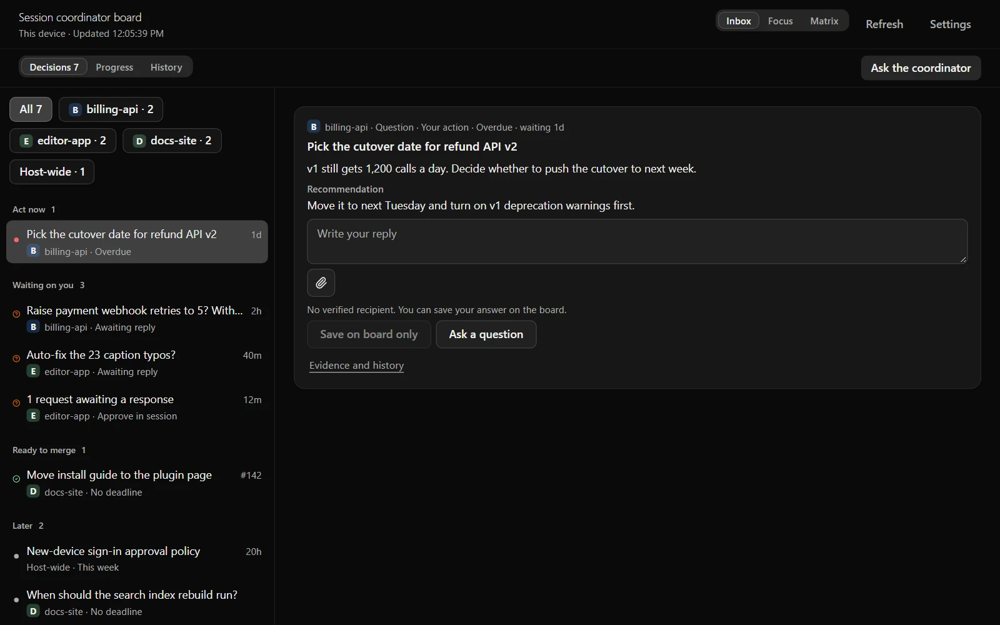
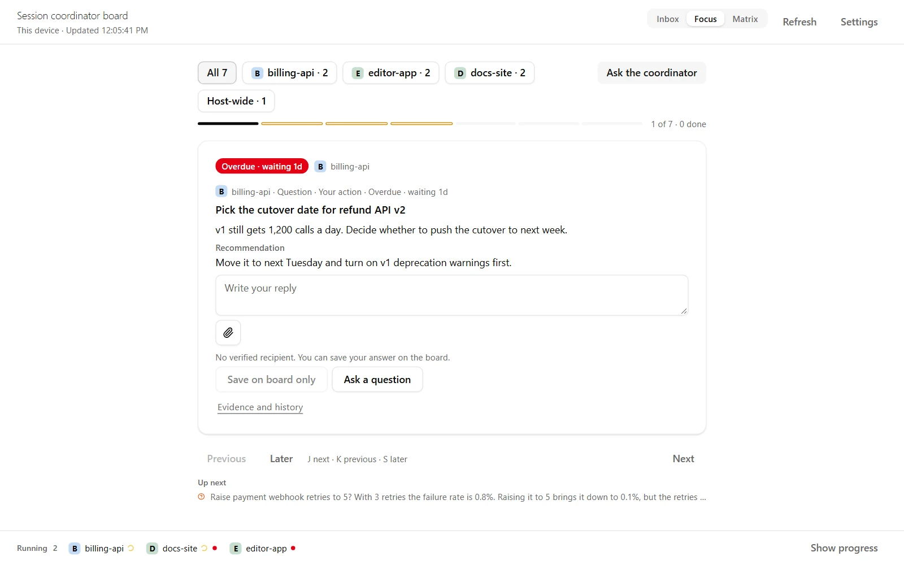
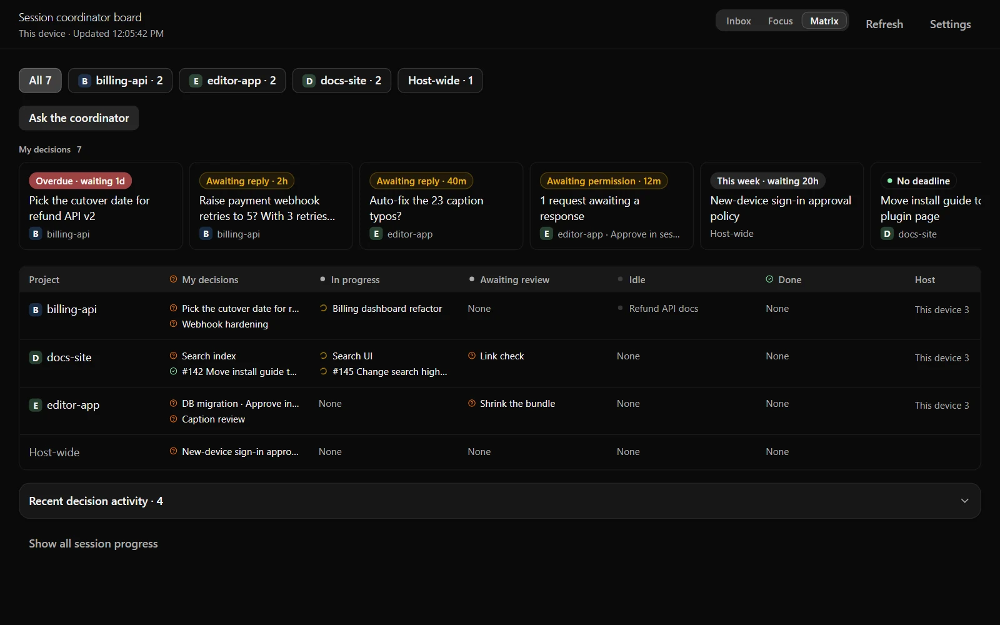
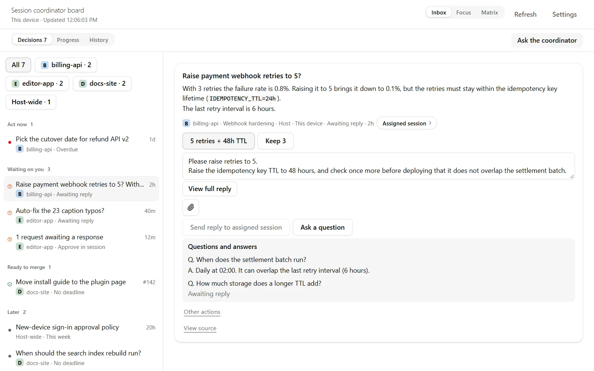
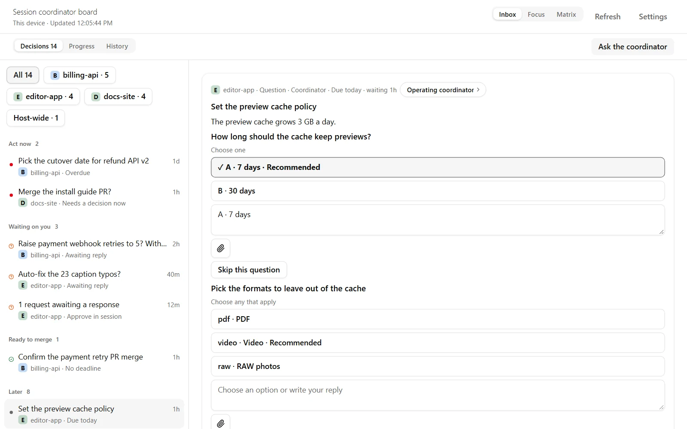
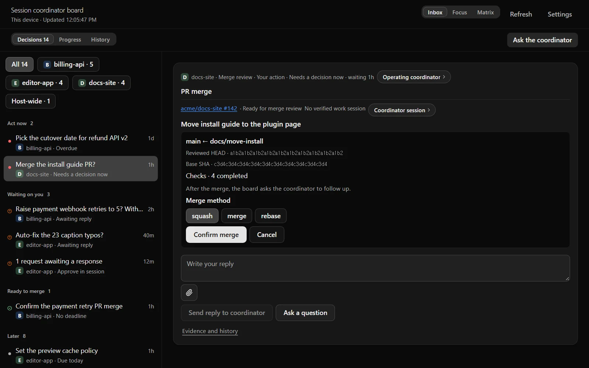

<div align="center">


# Coordinator Board

**나를 기다리는 에이전트 세션을 한곳에.**<br>
[Orca](https://github.com/stablyai/orca) 에이전트 세션을 프로젝트별로 모으고, 사람이 답하거나 승인해야 할 세션(질문, 권한 요청, 병합할 PR)을 보드 하나에 올려 그 자리에서 답하게 하는 Orca 플러그인입니다.

[](https://github.com/stablyai/orca-community-plugins)
[](https://github.com/stablyai/orca)
[](LICENSE)
[](https://github.com/devbrother2024/paseo-coordinator-board)

[English](README.md) · **한국어** · [日本語](README.ja.md) · [简体中文](README.zh-CN.md)


</div>

## 왜 만들었나

코딩 에이전트를 열 개쯤 함께 돌리면 병목은 사람이 됩니다. 하나는 질문을 하고, 하나는 권한을 기다리고, 하나는 한 시간 전에 PR을 열어 두었습니다. 모두 각자의 터미널이나 채팅 탭에 있습니다. Coordinator Board는 이 세션을 모두 지켜보다가 사람이 정해야 할 일을 순서대로 한 목록에 올립니다. 탭을 뒤지지 않고 차례로 답하면 됩니다.

## 기능

- **결정 대기열 하나.** 권한 요청, 질문, 확인을 요청하며 끝난 세션, 리뷰할 PR을 급한 순서로, 같은 급이면 오래 기다린 순서로 보여 줍니다.
- **그 자리에서 답장.** 답장 카드에 세션의 최근 출력과 코디네이터 추천이 나옵니다. 선택지 버튼은 답장을 채우기만 하고, 사람이 읽고 고친 뒤 보냅니다(⌘/Ctrl+Enter).
- **보기 세 가지.** **인박스**(목록과 상세), **집중**(결정 한 건씩, `J` / `K` / `S` 단축키), **매트릭스**(프로젝트와 세션 상태 표).
- **사이드바 패널.** Orca 오른쪽 사이드바에 집중 카드를 그대로 띄워 편집기를 떠나지 않고 답합니다. 상태바에는 대기 중인 결정 수가 나옵니다.
- **코디네이터 에이전트.** 코디네이터 세션을 새로 띄우거나 기존 세션을 지정합니다. 코디네이터는 `coordinator-board` 셸 명령으로 다이제스트를 쓰고, 답을 추천하고, 난이도 등급에 맞춰 작업자 에이전트를 배정합니다.
- **결정 기록.** 코디네이터가 단일 선택, 복수 선택 질문과 근거, 이력을 담은 기록을 남깁니다. 작업 중인 세션에 보낼 답은 대기열에 두었다가 턴이 끝나면 한 번 보냅니다.
- **PR 병합.** 대상 브랜치, 검토한 HEAD, 검사 상태를 확인하고 병합 방식을 골라 보드에서 병합합니다. 코디네이터에게 후속 작업을 알립니다.
- **작업 추적.** 코디네이터가 맡긴 작업은 완료 기준을 함께 가집니다. 보고 없이 끝난 턴이나 병합되거나 닫힌 PR은 완료 후보일 뿐이라 보드가 세션에 한 번 묻고, 완료 보고나 방치는 코디네이터에게 알립니다. 완료는 코디네이터의 `verify`나 사람만 확정합니다. `verify`는 작업을 두 번까지만 되돌리고, 세 번째 실패는 다시 돌리지 않고 사람의 결정 카드로 올립니다. 입력을 기다리는 작업은 시간이 지나도 방치로 보지 않습니다.
- **사진.** 답장, 질문, 코디네이터 요청에 사진을 4장까지(JPEG, PNG, WebP) 붙입니다.
- 한국어와 영어 화면, 밝은 테마와 어두운 테마를 지원합니다.

## 스크린샷

| 인박스 | 집중 |
| --- | --- |
|  |  |
| **매트릭스** | **선택지로 답장** |
|  |  |
| **결정 기록** | **보드에서 병합** |
|  |  |

## 설치

Orca 1.4.259 이상이 필요합니다.

**플러그인 목록에서:** Orca에서 **Settings → Plugins**를 열고, 커뮤니티 카탈로그에서 **Coordinator Board**를 찾아 설치합니다.

**명령줄에서:**

```sh
orca plugin install hseunghwan/orca-coordinator-board
```

코드를 실행하는 플러그인(trusted worker)이라 Orca가 요청 권한 목록과 `--approve <fingerprint>`가 붙은 명령을 보여 줍니다. 목록을 읽고 직접 승인합니다.

그다음 오른쪽 사이드바의 **Coordinator Board** 패널이나 상태바의 **Board**를 눌러 지켜볼 프로젝트를 고릅니다. PR 목록은 이 컴퓨터에 로그인된 `gh` CLI로 읽습니다. 없으면 PR 영역만 비어 보입니다.

### 요청하는 권한

| 권한 | 쓰는 곳 |
| --- | --- |
| `storage:own` | 상태바 문구의 언어 |
| `workspace:read` | 프로젝트, 워크스페이스, 터미널 목록 |
| `agent:read` | 에이전트 상태(권한 대기, 답 기다림, 작업 중, 완료) |
| `terminal:read` | 답장 카드의 터미널 최근 출력 |
| `terminal:send` | 사람이 쓰고 보내기를 누른 답장 입력 |
| `workspace:write` | 세션 터미널로 화면 옮기기, 채팅 워크스페이스와 대시보드 파일 열기 |
| `agent:launch` | 아직 쓰지 않음(코디네이터는 `orca agent launch` CLI로 띄움) |
| `history:read` | 아직 쓰지 않음 |

## 동작 방식

- **나오는 곳.** 상태바의 결정 수, 전체 폭 대시보드 탭(명령 팔레트: `Coordinator Board: Open dashboard`), 오른쪽 사이드바 패널.
- **대시보드 탭.** Orca 플러그인은 편집 탭을 직접 열 수 없어서, 대시보드는 `.coordinator-board` 파일 전용 에디터입니다. 열면 지금 워크스페이스에 `.coordinator-board/board.coordinator-board`를 씁니다. 이 파일은 `.git/info/exclude`로 숨기고 `.gitignore`는 만들지 않습니다. 파일에는 데이터가 없고 내용은 모두 워커가 읽습니다.
- **데이터.** 고른 프로젝트, 코디네이터, 메모, 답장 영수증은 `~/.orca-coordinator-board/`에 Paseo판과 같은 파일 형식으로 둡니다.
- **코디네이터.** 전용 폴더 프로젝트("코디네이터 운영")에서 `orca agent launch`로 띄웁니다. 실행 기록을 먼저 쓰므로 응답이 끊겨도 다시 확인만 하고 두 번 띄우지 않습니다. 작업자는 추천 권한 모드로 띄우고 우회 모드는 주지 않습니다.

### 전송 규칙

- 사람이 쓰고 보내기를 누른 글만, 쓴 그대로 세션에 입력합니다.
- 보내기 직전에 세션 상태를 다시 읽습니다. 권한 대기, 작업 중, 카드를 연 뒤 상태가 바뀐 세션에는 보내지 않습니다.
- 실패해도 자동으로 다시 보내지 않습니다.
- 보드가 스스로 만든 문장(사실 답, 병합 알림)은 터미널에서는 `[coordinator-board]` 머리말을 붙이고, 채팅 세션에는 서명한 메일로 보냅니다. 다른 경로로 바꿔 보내지 않습니다.

자세한 동작은 [docs/details.ko.md](docs/details.ko.md)에 있습니다.

## Paseo판과 다른 점

Orca가 주지 않는 기능이라 보드에서 뺐습니다. 워크스페이스 고정, 실행 중인 턴에 끼워 넣기, 작업자를 띄운 에이전트 기록(보드가 `workers.json`에 따로 남김), 터미널 에이전트의 권한 모드 읽기, 터미널이 닫힌 세션에 보내기.

## 개발

```sh
npm ci                  # 개발 도구만 설치. 플러그인 실행에는 node_modules가 필요 없음
orca plugin types .     # .orca/types 생성(git에 올리지 않음)
npm run build           # dist/worker.mjs, dist/cli.cjs, dist/dashboard.js, dist/dashboard.html
npm run typecheck
orca plugin test .      # vitest
orca plugin check .
orca plugin validate .
node dev/build.mjs      # 가짜 window.orca와 예시 보드로 대시보드 하네스 생성
node dev/shoot.mjs      # 헤드리스 Chrome/Edge로 dev/shots/에 화면 저장(목록용: node dev/shoot.mjs ^listing)
```

`dist/`는 저장소에 함께 올립니다. git으로 설치하면 빌드 없이 돕니다. 코딩 에이전트용 규칙은 [AGENTS.md](AGENTS.md)에 있습니다.

## 출처

이 플러그인은 DevBrothers의 **[paseo-coordinator-board](https://github.com/devbrother2024/paseo-coordinator-board)**(MIT)를 Orca용으로 옮긴 것입니다. 보드 구성, 결정 순서, 전송 규칙, PR 분류는 그 프로젝트에서 왔고, `src/paseo/`는 그 판단 로직과 테스트를 import 경로만 바꿔 옮겼습니다. 원작자분들께 감사드립니다.

함께 들어온 Marked와 Better Paseo 코드의 고지는 [THIRD_PARTY_NOTICES.md](THIRD_PARTY_NOTICES.md)에 있습니다. 프로젝트 뼈대는 Orca의 `orca plugin create` 템플릿(stablyai/orca, MIT)에서 시작했습니다.

## 라이선스

[MIT](LICENSE)
