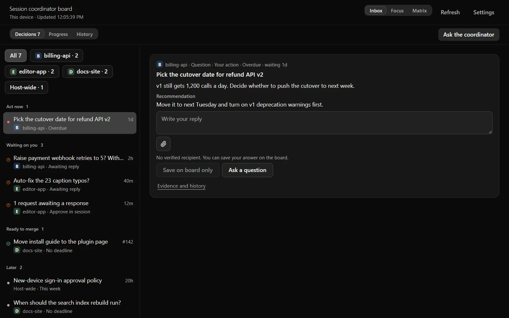
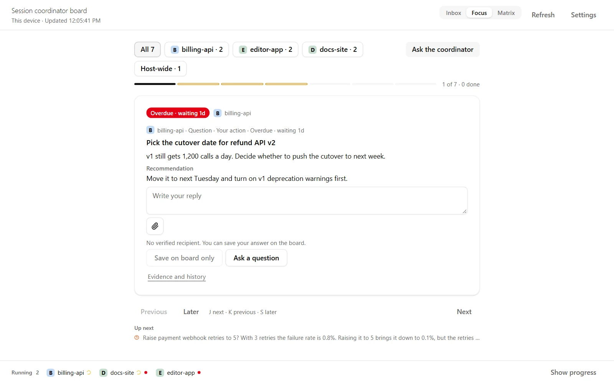
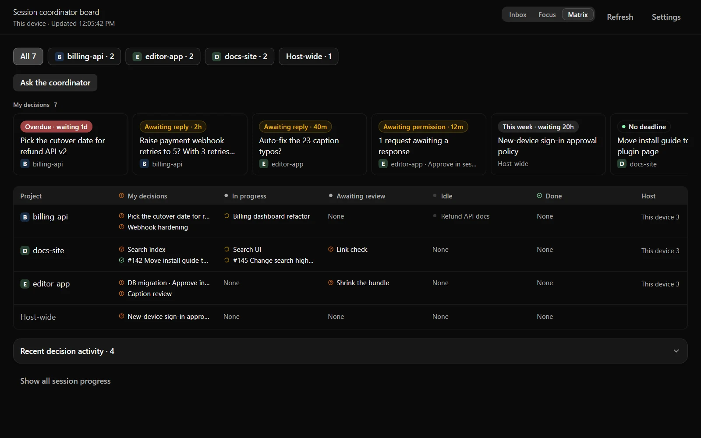
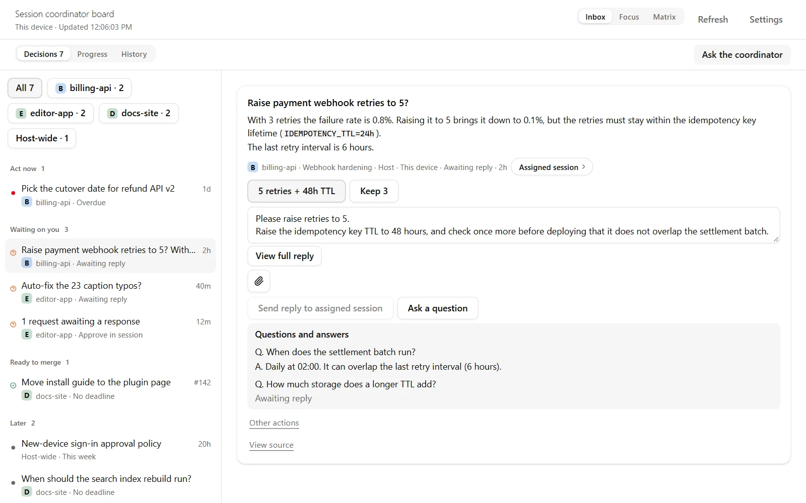
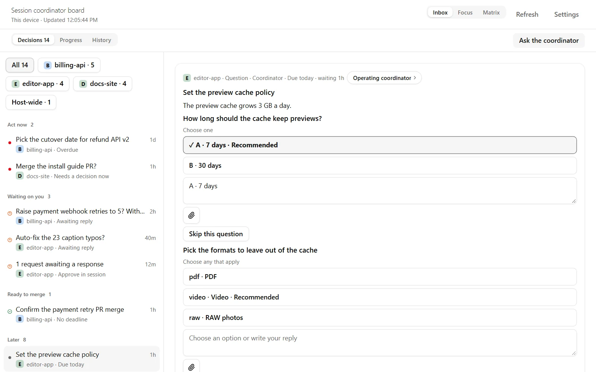
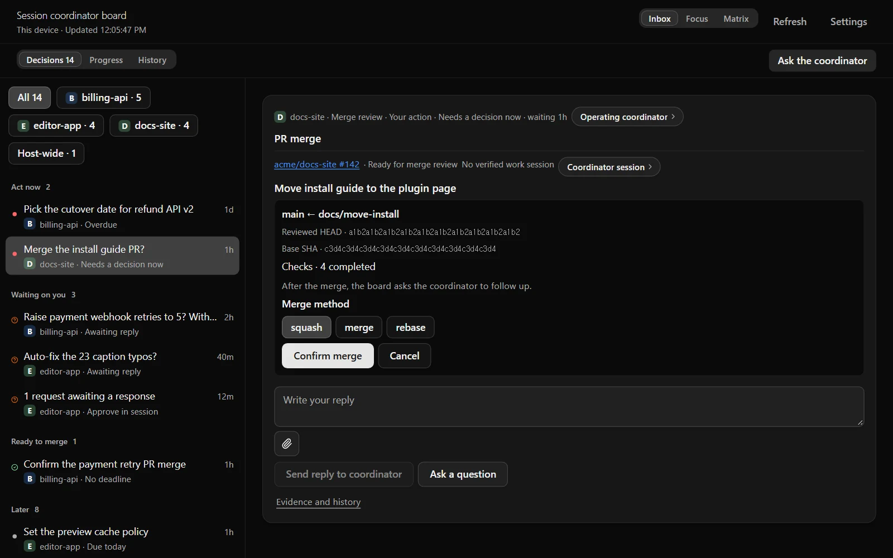

<div align="center">


# Coordinator Board

**Every agent session that is waiting on you, in one place.**<br>
An [Orca](https://github.com/stablyai/orca) plugin that groups your agent sessions by project and lifts the ones that need a human (a question, a permission, a pull request ready to merge) onto a single board you can answer from.

[](https://github.com/stablyai/orca-community-plugins)
[](https://github.com/stablyai/orca)
[](LICENSE)
[](https://github.com/devbrother2024/paseo-coordinator-board)

**English** · [한국어](README.ko.md) · [日本語](README.ja.md) · [简体中文](README.zh-CN.md)


</div>

## Why

Run five or ten coding agents at once and the bottleneck becomes you: one is asking a question, one needs a permission, one opened a PR an hour ago. Each lives in its own terminal or chat tab. Coordinator Board watches all of them and puts every decision that needs a person in one ordered list, so you answer them in a row instead of hunting through tabs.

## Features

- **One decision queue.** Permission requests, questions, sessions that ended with a request for confirmation, and reviewable PRs, ordered by urgency and then by how long they have waited.
- **Answer in place.** Reply cards show the session's recent output and the coordinator's recommendation. Option buttons fill the reply; you read it, edit it and press send (⌘/Ctrl+Enter).
- **Three views.** **Inbox** (list and detail), **Focus** (one decision at a time, with `J` / `K` / `S` shortcuts) and **Matrix** (projects against session states).
- **Sidebar panel.** The same focus cards in Orca's right sidebar, answerable without leaving your editor. A status bar item shows how many decisions are waiting.
- **Coordinator agent.** Start or appoint a coordinator session that writes digests, recommends answers and dispatches worker agents by difficulty tier, using the `coordinator-board` shell command.
- **Decision records.** Coordinators leave structured records with single or multiple choice questions, evidence and history. Replies to busy sessions are queued and sent once when the turn ends.
- **Pull requests.** Review the target branch, reviewed HEAD and checks, pick a merge method and merge from the board. The coordinator is told to follow up.
- **Work tracking.** Work the coordinator assigns carries what done means. A turn that ends without a report, or a pull request that merges or closes, is only a done candidate: the board asks the session once, tells the coordinator when work is reported done or goes stale, and only the coordinator's `verify` or a person confirms done. `verify` sends work back at most twice; a third failure becomes a decision card for you instead of another round. Work waiting for input is never marked stale by time.
- **Photos.** Attach up to 4 images (JPEG, PNG, WebP) to replies, questions and coordinator requests.
- **Korean and English** interface, light and dark themes.

## Screenshots

| Inbox | Focus |
| --- | --- |
|  |  |
| **Matrix** | **Reply with options** |
|  |  |
| **Decision records** | **Merge from the board** |
|  |  |

## Install

Requires Orca 1.4.259 or later.

**From the plugin directory:** open Orca → **Settings → Plugins**, find **Coordinator Board** in the community catalog and install it.

**From the command line:**

```sh
orca plugin install hseunghwan/orca-coordinator-board
```

This plugin runs code (a trusted worker), so Orca shows the access it asks for and a command with `--approve <fingerprint>`. Read the list and approve it yourself.

Then open the **Coordinator Board** panel in the right sidebar (or click **Board** in the status bar) and pick the projects to watch. Pull requests are read with the `gh` CLI signed in on this computer; without it, only the PR section stays empty.

### Access it asks for

| Capability | Used for |
| --- | --- |
| `storage:own` | Status bar language |
| `workspace:read` | Projects, workspaces and terminals |
| `agent:read` | Agent status (permission, waiting, working, done) |
| `terminal:read` | Recent terminal output on reply cards |
| `terminal:send` | Typing a reply you wrote and sent |
| `workspace:write` | Focusing a session's terminal, opening chat workspaces and the dashboard file |
| `agent:launch` | Not used yet (the coordinator starts through the `orca agent launch` CLI) |
| `history:read` | Not used yet |

## How it works

- **Where it shows up.** A status bar count, a full-width dashboard tab (command palette: `Coordinator Board: Open dashboard`) and a right sidebar panel.
- **Dashboard tab.** Orca plugins cannot open an editor tab on their own, so the dashboard is a custom editor for `.coordinator-board` files. Opening it writes `.coordinator-board/board.coordinator-board` in the focused workspace (hidden through `.git/info/exclude`, never a new `.gitignore`). The file holds no data; the worker reads everything.
- **Data.** Selected projects, the coordinator, notes and reply receipts live in `~/.orca-coordinator-board/`, in the same file format as the Paseo version.
- **Coordinator.** Started with `orca agent launch` in a dedicated "Coordinator home" folder project. A launch record is written first, so a lost response is only re-checked, never launched twice. Workers get the recommended permission modes, never a bypass mode.

### Sending rules

- Only text you wrote and sent is typed into a session, exactly as written.
- Right before sending, the worker reads the session state again. Sessions waiting on a permission, working, or changed since you opened the card are skipped.
- Nothing is resent automatically after a failure.
- Text the board writes itself (fact answers, merge notices) is labeled with a `[coordinator-board]` header in terminals, or sent as signed mail to chat sessions. It is never retyped down another path.

More detail (in Korean): [docs/details.ko.md](docs/details.ko.md).

## Differences from the Paseo version

Orca does not offer the following, so the board leaves them out: pinning workspaces, steering a running turn, recording which agent launched a worker (the board keeps it in `workers.json`), reading a terminal agent's permission mode, and sending to sessions whose terminal is closed.

## Development

```sh
npm ci                  # dev tools only; the plugin itself needs no node_modules
orca plugin types .     # writes .orca/types (not committed)
npm run build           # dist/worker.mjs, dist/cli.cjs, dist/dashboard.js, dist/dashboard.html
npm run typecheck
orca plugin test .      # vitest
orca plugin check .
orca plugin validate .
node dev/build.mjs      # dashboard harness with a fake window.orca and an invented board
node dev/shoot.mjs      # headless Chrome/Edge screenshots into dev/shots/ (listing shots: node dev/shoot.mjs ^listing)
```

`dist/` is committed so a git install runs without a build. Rules for coding agents are in [AGENTS.md](AGENTS.md).

## Credits

This plugin is an Orca port of **[paseo-coordinator-board](https://github.com/devbrother2024/paseo-coordinator-board)** by DevBrothers (MIT). The board layout, decision ordering, sending rules and PR classification come from that project, and `src/paseo/` carries its decision logic and tests with only import paths changed. Thank you to its authors.

Notices for bundled Marked and Better Paseo code are in [THIRD_PARTY_NOTICES.md](THIRD_PARTY_NOTICES.md). The project skeleton started from Orca's `orca plugin create` template (stablyai/orca, MIT).

## License

[MIT](LICENSE)
