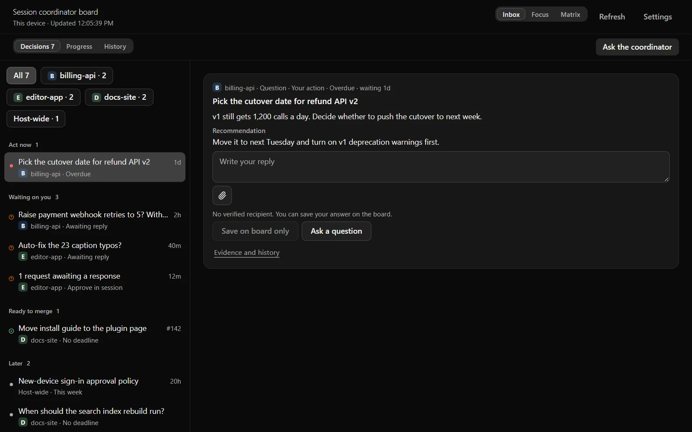
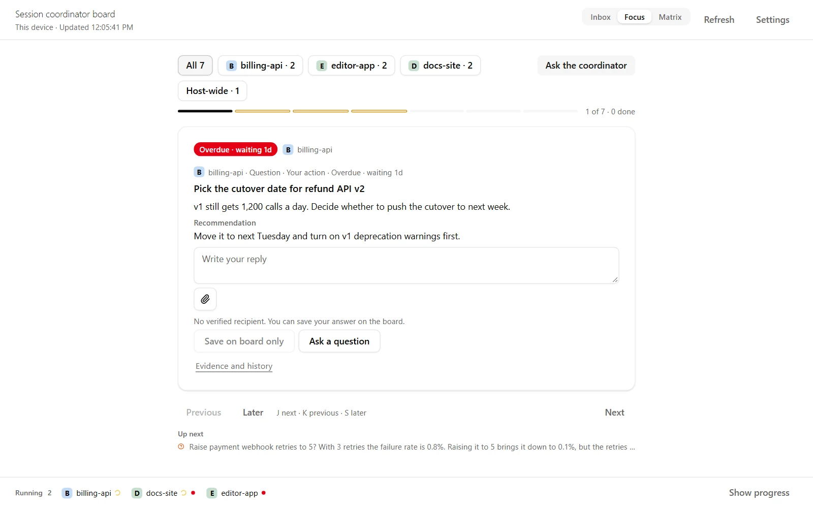
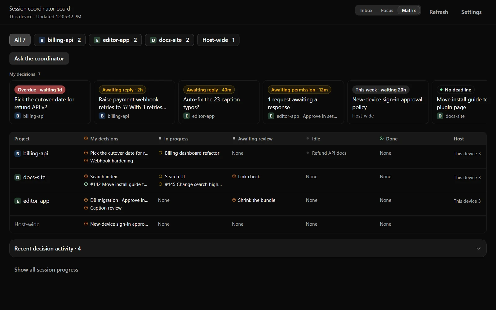
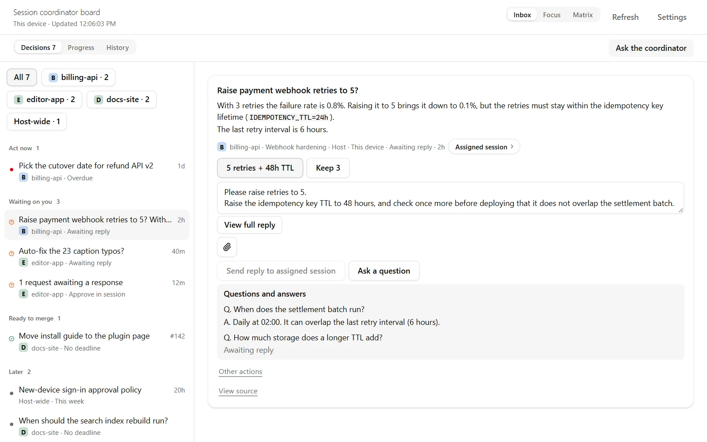
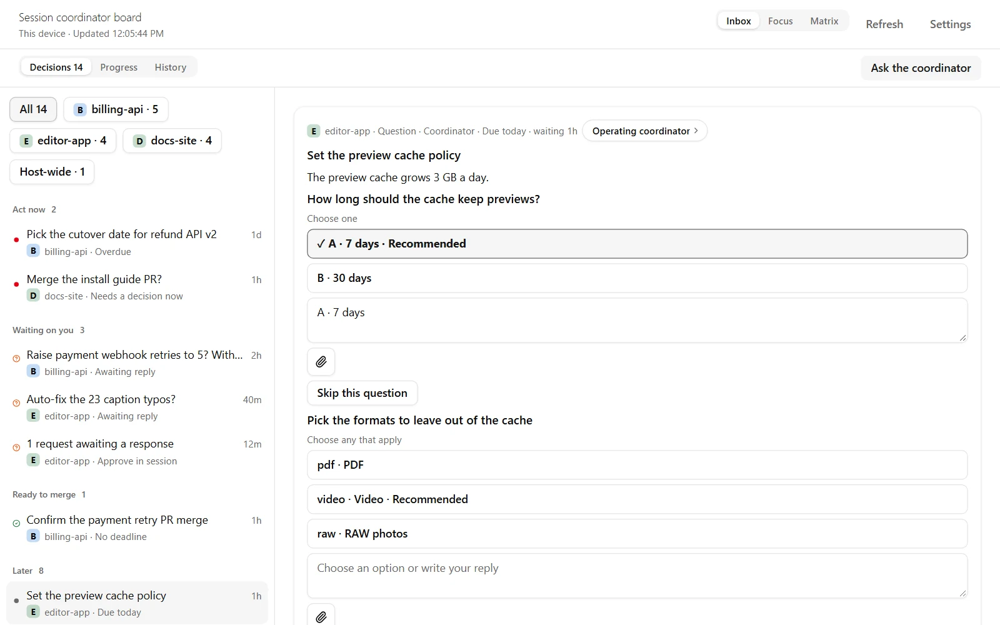
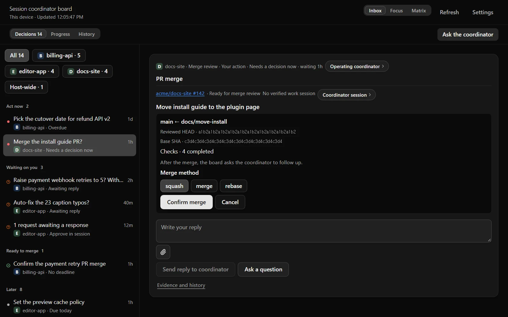

<div align="center">


# Coordinator Board

**所有在等你的智能体会话，集中在一处。**<br>
一个 [Orca](https://github.com/stablyai/orca) 插件：按项目归集你的智能体会话，把需要人来处理的事项（提问、权限请求、可合并的 PR）放到同一块看板上，并让你在原地直接回复。

[](https://github.com/stablyai/orca-community-plugins)
[](https://github.com/stablyai/orca)
[](LICENSE)
[](https://github.com/devbrother2024/paseo-coordinator-board)

[English](README.md) · [한국어](README.ko.md) · [日本語](README.ja.md) · **简体中文**


</div>

## 为什么做它

同时运行五个、十个编码智能体时，瓶颈就变成了你自己：一个在提问，一个在等权限，一个一小时前就开了 PR。它们分散在各自的终端或聊天标签页里。Coordinator Board 会盯着所有会话，把需要人来决定的事按顺序放进一个列表。你不用再翻找标签页，按顺序逐条回复即可。

## 功能

- **统一的决策队列。** 权限请求、提问、以确认请求结束的会话、可评审的 PR，按紧急程度排序，同等紧急时等待越久越靠前。
- **原地回复。** 回复卡片显示会话最近的输出和协调者的建议。选项按钮只会填入回复内容，由你阅读、修改后再发送（⌘/Ctrl+Enter）。
- **三种视图。** **Inbox**（列表与详情）、**Focus**（一次一条，支持 `J` / `K` / `S` 快捷键）、**Matrix**（项目 × 会话状态）。
- **侧边栏面板。** 在 Orca 右侧边栏显示同样的 Focus 卡片，无需离开编辑器即可回复。状态栏显示待处理决策的数量。
- **协调者智能体。** 启动一个协调者会话或指定已有会话。它通过 `coordinator-board` 命令行撰写摘要、推荐答复，并按难度等级分派工作智能体。
- **决策记录。** 协调者会留下包含单选、多选问题以及依据和历史的记录。发给忙碌会话的回复会先排队，等其回合结束后发送一次。
- **合并 PR。** 确认目标分支、已评审的 HEAD 和检查状态，选择合并方式后直接在看板上合并，并通知协调者跟进。
- **任务跟踪。** 协调者分配的任务带有完成标准。没有汇报就结束的回合，或已合并、已关闭的 PR，只算完成候选：看板会向会话询问一次，任务汇报完成或停滞时通知协调者，只有协调者的 `verify` 或人能确认完成。`verify` 最多退回两次，第三次失败不再重来，而是变成交给你的决定卡片。等待输入的任务不会因时间过去而被视为停滞。
- **图片。** 回复、提问和协调者请求最多可附 4 张图片（JPEG、PNG、WebP）。
- 支持韩语和英语界面，以及浅色和深色主题。

## 截图

| Inbox | Focus |
| --- | --- |
|  |  |
| **Matrix** | **用选项回复** |
|  |  |
| **决策记录** | **在看板上合并** |
|  |  |

## 安装

需要 Orca 1.4.259 或更高版本。

**从插件目录安装：** 在 Orca 中打开 **Settings → Plugins**，在社区目录中找到 **Coordinator Board** 并安装。

**通过命令行安装：**

```sh
orca plugin install hseunghwan/orca-coordinator-board
```

该插件会运行代码（trusted worker），因此 Orca 会列出它请求的权限，以及一条带 `--approve <fingerprint>` 的命令。请阅读列表后自行批准。

之后点击右侧边栏的 **Coordinator Board** 面板或状态栏的 **Board**，选择要关注的项目。PR 通过本机已登录的 `gh` CLI 读取；没有它时，只有 PR 区域为空。

### 请求的权限

| 权限 | 用途 |
| --- | --- |
| `storage:own` | 状态栏文字的语言 |
| `workspace:read` | 项目、工作区和终端列表 |
| `agent:read` | 智能体状态（等待权限、等待回复、工作中、已完成） |
| `terminal:read` | 回复卡片上显示的终端最近输出 |
| `terminal:send` | 输入你写好并点击发送的回复 |
| `workspace:write` | 切换到会话终端，打开聊天工作区和看板文件 |
| `agent:launch` | 暂未使用（协调者通过 `orca agent launch` CLI 启动） |
| `history:read` | 暂未使用 |

## 工作原理

- **出现的位置。** 状态栏计数、全宽看板标签页（命令面板：`Coordinator Board: Open dashboard`）以及右侧边栏面板。
- **看板标签页。** Orca 插件无法自行打开编辑器标签页，因此看板是 `.coordinator-board` 文件的自定义编辑器。打开时会在当前工作区写入 `.coordinator-board/board.coordinator-board`（通过 `.git/info/exclude` 隐藏，不会新建 `.gitignore`）。该文件不含数据，所有内容都由 worker 读取。
- **数据。** 所选项目、协调者、备注和回复回执保存在 `~/.orca-coordinator-board/`，格式与 Paseo 版相同。
- **协调者。** 在专用的文件夹项目（“Coordinator home”）中通过 `orca agent launch` 启动。系统会先写入启动记录，因此即使响应中断也只会重新确认，不会重复启动。工作智能体使用推荐的权限模式，绝不使用绕过模式。

### 发送规则

- 只会把你写好并点击发送的文字，原样输入到会话中。
- 发送前会重新读取会话状态。等待权限、正在工作、或在你打开卡片后状态已变化的会话都不会发送。
- 失败后不会自动重发。
- 看板自己生成的文字（事实答复、合并通知）在终端中会带上 `[coordinator-board]` 标头，发给聊天会话时则使用签名邮件。不会改走其他路径发送。

更多细节（韩语）：[docs/details.ko.md](docs/details.ko.md)

## 与 Paseo 版的区别

以下功能 Orca 未提供，因此看板中没有：固定工作区、插入正在运行的回合、记录是哪个智能体启动了工作智能体（看板另行保存在 `workers.json`）、读取终端智能体的权限模式、向终端已关闭的会话发送。

## 开发

```sh
npm ci                  # 仅安装开发工具；插件运行不需要 node_modules
orca plugin types .     # 生成 .orca/types（不提交）
npm run build           # dist/worker.mjs, dist/cli.cjs, dist/dashboard.js, dist/dashboard.html
npm run typecheck
orca plugin test .      # vitest
orca plugin check .
orca plugin validate .
node dev/build.mjs      # 用伪造的 window.orca 和虚构看板生成看板测试页
node dev/shoot.mjs      # 用无头 Chrome/Edge 将截图保存到 dev/shots/（上架用：node dev/shoot.mjs ^listing）
```

`dist/` 会提交到仓库，通过 git 安装时无需构建即可运行。面向编码智能体的规则见 [AGENTS.md](AGENTS.md)。

## 致谢

本插件是 DevBrothers 的 **[paseo-coordinator-board](https://github.com/devbrother2024/paseo-coordinator-board)**（MIT）的 Orca 移植版。看板布局、决策排序、发送规则和 PR 分类都来自该项目，`src/paseo/` 收录了它的判断逻辑和测试，仅修改了 import 路径。感谢原作者们。

随附的 Marked 和 Better Paseo 代码的声明见 [THIRD_PARTY_NOTICES.md](THIRD_PARTY_NOTICES.md)。项目骨架源自 Orca 的 `orca plugin create` 模板（stablyai/orca，MIT）。

## 许可证

[MIT](LICENSE)
